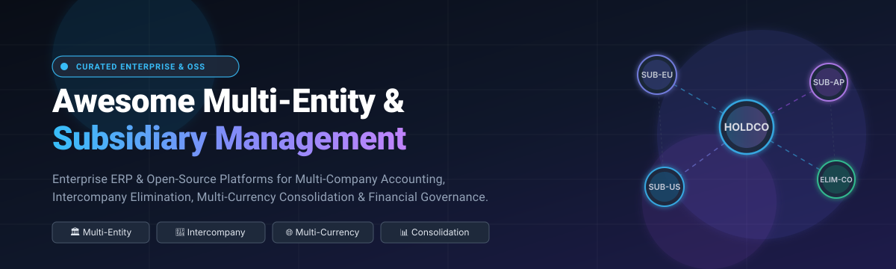

  

# 🌐 Awesome Multi-Entity & Subsidiary Management 🏢

  

 

> 🌟 **A curated list of top Multi-Entity, Multi-Company, and Subsidiary Management platforms** — comparing enterprise SaaS ERP and accounting suites alongside self-hosted open-source alternatives for complex corporate hierarchies, intercompany eliminations, transfer pricing, multi-currency reporting, and consolidated balance sheets.
>
> ⭐ **Star this repository if you find it valuable for your corporate financial architecture!** ⭐

---

## 📑 Table of Contents

- [📈 Sector Overview & Market Dynamics](#-sector-overview--market-dynamics)
- [🟦 SaaS / Hosted Commercial Platforms](#-saas--hosted-commercial-platforms)
  - [🏢 Enterprise Comparison Matrix](#-enterprise-comparison-matrix)
  - [🔍 Deep Dives: SaaS Solutions](#-deep-dives-saas-solutions)
- [🟩 Open-Source Software Platforms](#-open-source-software-platforms)
  - [⭐ Open-Source Comparison & Community Traction](#-open-source-comparison--community-traction)
  - [🔍 Deep Dives: Open-Source Solutions](#-deep-dives-open-source-solutions)
- [📊 Architectural Comparison at a Glance](#-architectural-comparison-at-a-glance)
- [💡 Key Concepts in Multi-Entity Management](#-key-concepts-in-multi-entity-management)
- [🤝 Contributing](#-contributing)
- [💖 Support & Sponsorship](#-support--sponsorship)
- [📈 Star History](#-star-history)
- [📄 License](#-license)

---

## 📈 Sector Overview & Market Dynamics

The global market for **Enterprise Resource Planning (ERP)** and financial multi-entity management software is valued at approximately **$64B–$70B+ (expanding toward $145B+ across comprehensive enterprise application and service suites at ~11% CAGR)**, with dedicated core multi-entity accounting software surpassing **$20B–$23B**. The sector is **moderately concentrated among legacy enterprise titans** (Microsoft, Oracle, SAP) for global Fortune 500 consolidations, yet increasingly **fragmented across the mid-market and cloud ecosystem**, where specialized agile suites and open-source frameworks compete vigorously to address cross-border e-commerce, multinational subsidiaries, holding company structures, and modern remote operations.

---

## 🟦 SaaS / Hosted Commercial Platforms

Commercial, cloud-hosted Multi-Entity and Subsidiary Management platforms engineered for automated financial consolidation, intercompany eliminations, statutory tax compliance across nexuses, and cross-border currency translation.

### 🏢 Enterprise Comparison Matrix

Platforms are sorted in descending order by parent company market capitalization and scale:

| 🏷️ Product | 🏢 Company | 💰 Company Valuation / Market Cap | 💳 Starting Tier Pricing | 🎁 Free Tier / Trial Limit | 🌐 Consolidation & Multi-Entity Model |
|:---|:---|:---|:---|:---|:---|
| **[Microsoft Dynamics 365 Finance](https://dynamics.microsoft.com/en-us/finance/)** | Microsoft Corporation | **~$3,100 Billion** ($3.1T+) | **$210 / user / month** (Base license; 20-user minimum; attach license available at $30/user/mo) | **30-Day Free Trial** (Guided sandbox with sample global financial chart of accounts) | Legal entities with cross-company data sharing policies, intercompany trade & automated elimination |
| **[Oracle Fusion Cloud ERP](https://www.oracle.com/erp/)** | Oracle Corporation | **~$556 Billion** | **$175 / user / month** (Financials module list price; PPM at $120/mo; min. 10–25 user commitment) | **No Free Trial** (Live guided proof-of-concept demos via enterprise sales; OCI $300 credit excludes ERP) | Multi-Org architecture with Reference Organizations and centralized security inheritance |
| **[NetSuite OneWorld](https://www.netsuite.com/portal/products/erp/financial-management/oneworld.shtml)** | Oracle Corporation (NetSuite) | **~$556 Billion** (Parent: Oracle) | **~$2,000 – $2,500 / month** base platform + **$125 – $199 / user / month** + subsidiary packs | **No Public Free Trial** (Custom guided vendor simulations & sandbox demos; select partner 14-day single-entity trials) | Hierarchical subsidiary tree (up to 250 entities), automated CTA equity balancing & elimination journals |
| **[SAP S/4HANA Cloud (Public Edition)](https://www.sap.com/products/erp/s4hana.html)** | SAP SE | **~$282 Billion** | **~$180 – $400 / user / month** (Tier-dependent; typical entry package min. 15 users) | **14-Day Free Trial** (Pre-configured public edition guided business tours & pre-loaded sample data) | Company codes with automated cross-company code clearing, central payment & internal billing |
| **[Sage Intacct Multi-Entity](https://www.sage.com/en-us/products/sage-intacct/)** | The Sage Group plc | **~$13 Billion** (£10.5B) | **~$1,000 / month** (Starts ~$11,000 – $12,000 / year base single user; avg. package $20k–$35k/yr) | **30-Day Free Trial** (Provisioned through certified Sage partners with tailored multi-entity demo data) | Dimensional multi-entity tagging, automated intercompany transaction eliminations & multi-currency |

---

### 🔍 Deep Dives: SaaS Solutions

#### 💼 NetSuite OneWorld
- **Architecture:** Cloud ERP with hierarchical subsidiary consolidation tree.
- **Entity Limits & Features:** Supports up to **250 subsidiaries** per account (elimination and inactive subsidiaries do not count toward this limit). The country defined on the subsidiary record automatically determines statutory tax nexuses and currency models.
- **Intercompany & Consolidations:** Financial statements leverage a Cumulative Translation Adjustment (CTA) equity account to reconcile balance sheet discrepancies. Elimination subsidiaries handle cross-subsidiary billing, shared inventory movements, and automated journal adjustments.
- **Best Suited For:** Fast-growing mid-market to upper-midmarket international corporations seeking proven multi-subsidiary governance with built-in multi-currency handling.

#### 💼 SAP S/4HANA Multi-Company
- **Architecture:** Enterprise ERP driven by modular company code configurations.
- **Cross-Company Mechanics:** Transactions execute at the individual company code level. Features automated cross-company code clearing for centralized procurement and disbursement (e.g., entity A procures inventory while entity B disburses payment, automatically posting intercompany receivables and payables).
- **Advanced Manufacturing & Transfers:** Cross-company make-to-order allows cost collection in one entity while recognizing revenue in another, settling balance gaps through automated internal billing.
- **Best Suited For:** Large global conglomerates and enterprise supply chains requiring complex transfer pricing, multi-tier taxation, and centralized treasury management.

#### 💼 Microsoft Dynamics 365 Multi-Company
- **Architecture:** Enterprise ERP with legal entity boundaries and cross-company data sharing (CCDS).
- **Data Sharing Engine:** Enables duplicate record or master-company synchronization policies across up to 300 companies and 2 million records per table.
- **Consolidation Mechanics:** Supports single-level and multi-level consolidations, automatic eliminations, minority interest tracking, disparate charts of accounts, and differing fiscal calendars with multiple functional and reporting currencies.
- **Best Suited For:** Microsoft-centric enterprises that demand deep integration with Azure, Power BI, and Microsoft Office alongside customizable intercompany trade relationships.

#### 💼 Oracle Fusion Cloud Multi-Org
- **Architecture:** High-security enterprise cloud ERP utilizing Reference Organizations.
- **Security & Item Governance:** Centralizes item definition security while inheriting permissions across all associated reference organizations, eliminating redundant administration across divisions.
- **Access Control:** Integrates fine-grained policy-based access control across global compartments, cost centers, and multi-national operating units.
- **Best Suited For:** Tier-1 global institutions requiring rigorous security policies, shared master catalog inheritance, and high-volume multi-organization transactional controls.

#### 💼 Sage Intacct Multi-Entity
- **Architecture:** Cloud financial management powered by continuous multi-dimensional tagging.
- **Consolidation & Reporting:** Entities, departments, locations, and projects are recorded as dimensional tags on every transaction. Real-time consolidated rollups occur without waiting for month-end batch processing, supported by automated elimination entries.
- **Best Suited For:** Scale-ups, asset managers, SaaS companies, and non-profits seeking sophisticated multi-entity financial reporting without the operational overhead of a monolithic ERP.

---

## 🟩 Open-Source Software Platforms

Self-hosted, transparent, and customizable open-source ERP systems, accounting libraries, and multi-tenant frameworks. 

### ⭐ Open-Source Comparison & Community Traction

Sorted in descending order by GitHub repository Stars_Count:

| 🏷️ Project | ⭐ GitHub_Stars | 💻 Tech Stack | 📜 License | 🏢 Multi-Company Structure | 🗄️ Self-Hosted Architecture |
|:---|:---|:---|:---|:---|:---|
| **[Odoo](https://github.com/odoo/odoo)** |  | Python, JavaScript, PostgreSQL | LGPL-3.0 | Native multi-company environments with shared partners, multi-currency charts of accounts & inter-company rule automations | Full Web Application (Docker, On-Prem, Cloud) |
| **[ERPNext](https://github.com/frappe/erpnext)** |  | Python (Frappe Framework), MariaDB, Redis | GPL-3.0 | Tree hierarchy of companies, consolidated charts of accounts, internal transfer invoices & multi-currency revaluations | Full ERP Suite (Docker, Bench CLI, Cloud) |
| **[Akaunting](https://github.com/akaunting/akaunting)** |  | PHP (Laravel), MySQL / PostgreSQL | GPL-3.0 (Core) | Multi-company and multi-user switching from a unified portal; distinct ledgers per company | Web App (Docker, Composer, LAMP) |
| **[Django Ledger](https://github.com/arrobalytics/django-ledger)** |  | Python (Django framework) | MIT | Native multi-tenant entity management, hierarchical charts of accounts, financial reporting APIs | Developer Library & Pluggable Django App |
| **[ADempiere](https://github.com/adempiere/adempiere)** |  | Java, PostgreSQL / Oracle | GPL-2.0 | Multi-client, multi-organization, multi-currency accounting schemas with inter-organization inventory & billing | Enterprise Application Server |
| **[LedgerSMB](https://github.com/ledgersmb/LedgerSMB)** |  | Perl, PostgreSQL | GPL-2.0 | Isolated database per company, simultaneous multi-company tab sessions in a single browser, shared user logins | Web Application (Docker, Linux package) |
| **[Moqui Framework](https://github.com/moqui/moqui-framework)** |  | Java, Groovy, PostgreSQL / MySQL | CC0-1.0 | Universal Data Model (UDM) organization hierarchies, internal party relationships & multi-company ledgers | Enterprise Application Framework |
| **[Tryton](https://github.com/tryton/tryton)** |  | Python, PostgreSQL | GPL-3.0 | Native Company module supporting multi-company hierarchies, intercompany transactions & user-company assignments | Modular 3-Tier Server, Web & Desktop Clients |
| **[Bizuno](https://github.com/phreesoft/bizuno)** |  | PHP, WordPress / MySQL | GPL-3.0 | Multi-business, multi-location and multi-warehouse instances from a single self-hosted installation | WordPress Plugin / Web Platform |

---

### 🔍 Deep Dives: Open-Source Solutions

#### 📦 Odoo (Community Edition)
- **Tech Stack:** Python, JavaScript, PostgreSQL
- **Multi-Entity Capabilities:** Allows users to configure and toggle between multiple operating companies within a single database instance. Features synchronized master partner records, intercompany rule automation (generating vendor bills automatically from customer invoices in another subsidiary), and independent charts of accounts.
- **Strengths:** Huge app ecosystem, active community, and modern responsive UI.

#### 📦 ERPNext (Frappe Framework)
- **Tech Stack:** Python (Frappe), MariaDB, Redis
- **Multi-Entity Capabilities:** Provides a hierarchical Company tree structure where child companies roll up to a parent entity. Offers consolidated balance sheets and profit & loss statements across entities, inter-company purchase/sales orders, and automatic foreign currency exchange gains/losses revaluations.
- **Strengths:** 100% open-source core with complete ERP capabilities (manufacturing, HR, CRM, accounting) included without proprietary paywalls.

#### 📦 Akaunting
- **Tech Stack:** PHP (Laravel), MySQL
- **Multi-Entity Capabilities:** Supports managing multiple separate companies from a single dashboard. Users can invite different accountants or team members with granular permission levels per company entity.
- **Strengths:** Clean, accessible user interface ideal for freelancers, agencies, and small holding businesses managing distinct brand entities.

#### 📦 Django Ledger
- **Tech Stack:** Python, Django
- **Multi-Entity Capabilities:** Built from the ground up with multi-tenancy and multiple legal entities in mind. Allows developers to programmatically generate charts of accounts, post double-entry journal vouchers, and generate balance sheets, income statements, and cash flows across entities.
- **Strengths:** Direct library integration into custom web applications, SaaS platforms, and internal fintech backends.

#### 📦 ADempiere
- **Tech Stack:** Java, PostgreSQL / Oracle
- **Multi-Entity Capabilities:** Incorporates multi-tenant, multi-client, and multi-organization concepts directly into its database model. Capable of supporting distinct accounting schemas with different base currencies for multiple subsidiaries under one tenant.
- **Strengths:** Proven industrial and wholesale enterprise architecture for complex supply chains.

#### 📦 LedgerSMB
- **Tech Stack:** Perl, PostgreSQL
- **Multi-Entity Capabilities:** Employs an isolated PostgreSQL database schema per company. Users can run concurrent sessions across multiple subsidiaries in separate browser tabs simultaneously without session conflicts.
- **Strengths:** Exceptional database-enforced financial integrity and auditability.

#### 📦 Moqui Framework
- **Tech Stack:** Java, Groovy, PostgreSQL
- **Multi-Entity Capabilities:** Employs an enterprise-grade Universal Data Model (UDM) that models complex multi-tiered organizations, divisions, holding entities, and joint ventures as formal party relationships with full ledger segregation.
- **Strengths:** Flexible headless framework for building high-scale transactional ERP systems.

#### 📦 Tryton
- **Tech Stack:** Python, PostgreSQL
- **Multi-Entity Capabilities:** Native `company` module lets organizations define parent-child corporate structures. Employees are linked directly to companies, enforcing access rules at model, action, field, and record levels.
- **Strengths:** Pure modular architecture backed by clean Python code, strict automated testing, and five-year Long Term Support (LTS) releases.

#### 📦 Bizuno
- **Tech Stack:** PHP, WordPress, MySQL
- **Multi-Entity Capabilities:** Evolved from PhreeBooks; supports operating multiple businesses, warehouses, or legal branches within a single installation with robust audit logging.
- **Strengths:** Rapid deployment for small business owners already operating on WordPress infrastructure.

---

## 📊 Architectural Comparison at a Glance

| Feature / Dimension | Enterprise SaaS (NetSuite, SAP, D365) | Open-Source Platforms (Odoo, ERPNext, Tryton) | Developer Engines (Django Ledger, Moqui) |
|:---|:---|:---|:---|
| **Consolidation Automation** | ⚡ High (Automated elimination journals, CTA equity balancing) | 🔧 Medium to High (Built-in consolidated P&L, tree rollups) | 🛠️ Programmatic (API-driven / custom rules) |
| **Multi-Jurisdiction Tax** | 🏛️ Comprehensive (Built-in tax nexuses, VAT/GST compliance) | 🌐 Extensible (Localization modules & community packs) | 🧩 Custom implementation required |
| **Intercompany Clearing** | 🔄 Automated AR/AP offset & internal settlement workflows | 📝 Rule-driven intercompany invoice pair generation | 💻 Developer-defined ledger transactions |
| **Data Ownership & Privacy** | ☁️ Vendor-managed multi-tenant cloud | 🔒 100% On-Premise / Private Cloud data sovereign | 🔐 Complete application & database-level control |
| **TCO & Pricing Predictability** | 🏷️ High recurring cost ($15k–$150k+/yr + implementation) | 💸 Low software licensing fee; self-hosted infrastructure | 💡 Free open-source license; development resource costs |

---

## 💡 Key Concepts in Multi-Entity Management

Understanding the terminology of multi-subsidiary financial systems:

- **🏛️ Legal Entity vs. Operating Unit:** A legal entity is a registered corporate body with statutory filing requirements, while an operating unit or division may be an internal profit/cost center.
- **🔄 Intercompany Eliminations:** Offsetting transactions between related subsidiaries (e.g., entity A sells consulting to entity B) must be removed during group consolidation to prevent revenue inflation.
- **💱 Cumulative Translation Adjustment (CTA):** An equity reserve account on the consolidated balance sheet holding unrealized gains or losses resulting from translating foreign subsidiary assets and liabilities into the parent currency.
- **📑 Multi-Book Accounting:** Maintaining multiple parallel general ledgers for a single subsidiary to adhere simultaneously to local statutory GAAP and corporate IFRS requirements.
- **⚖️ Transfer Pricing:** Pricing rules governing transactions between parent and subsidiary companies to maintain arm's length compliance for international tax authorities.

---

## 🤝 Contributing

Contributions, feature suggestions, and updates are warmly welcomed! 

If you would like to submit an open-source or commercial multi-entity platform:
1. Fork this repository 🍴
2. Create your feature branch (`git checkout -b feature/add-new-tool`)
3. Ensure the project provides clear multi-company or multi-subsidiary capabilities.
4. Add your tool with tech stack, licensing, and multi-entity attributes.
5. Commit your changes and open a Pull Request! 🚀

---

## 💖 Support & Sponsorship

Thank you so much for using and exploring this curated repository! If you find this project valuable for your work, team, or enterprise architecture research, please consider supporting it:

- ⭐ **Star** this repository to help others discover it.
- 🍴 **Fork** and contribute new tools or improve existing data.
- 📢 **Share** it on LinkedIn, Twitter/X, Reddit, or your favorite developer/finance community.
- ☕ **Buy me a coffee / Sponsor**: If this project saved you hours of research, you can support future maintenance and development directly on GitHub:

---

## 📈 Star History

---

## 📄 License

This repository is distributed under the [CC0 1.0 Universal (Public Domain Dedication)](LICENSE). You are free to copy, modify, and distribute this work without asking permission.

---

  ⭐ <b>Found this curated list helpful? Give it a star to support open enterprise software documentation!</b> ⭐

